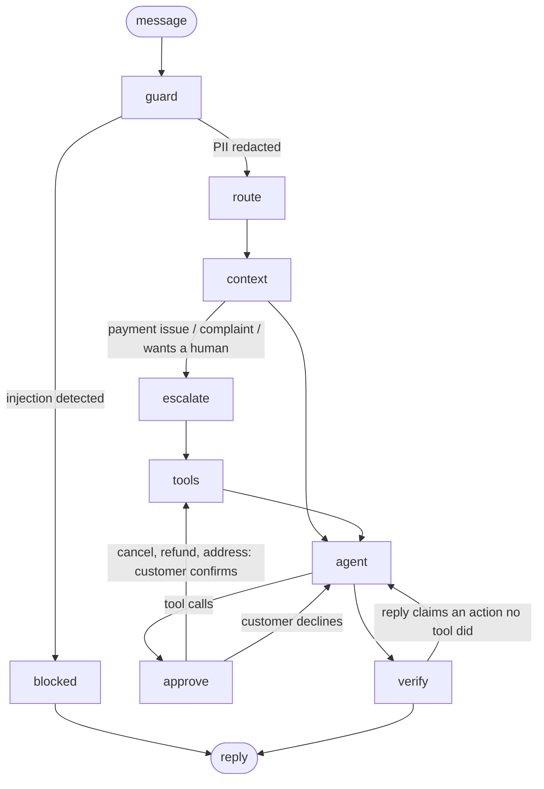

# support-agent

A customer support agent for **cellar**, a fictional wine, beer and spirits retailer. It looks up and changes orders, issues refunds within limits, answers stock questions using a demand forecast, and hands off to a human when it should. It asks before anything it can't undo, and checks every action it claims against the database before the customer sees the reply. It runs entirely on local models (Ollama).

Built with **LangGraph** (orchestration), **LlamaIndex** (retrieval), **MCP** (tool serving) and **Qwen** models on two consumer GPUs.

> **Status:** complete (3 days). The agent, tools, guardrails, MCP server, evals, a router comparison (prompting vs. retrieval vs. LoRA fine-tuning), a FastAPI service, a Next.js web demo, and a measured feedback loop.

## Results

### Agent (79 scenarios, ground truth checked against the database)

| Router | Core (49) | Hard (20) | Tool-call accuracy | Latency p50 / p95 |
|---|---|---|---|---|
| Prompting (qwen2.5:3b) | 49/49 | 20/20 | 100% | 4.1s / 7.2s |
| Fine-tuned (LoRA, Ollama) | 49/49 | 20/20 | 100% | 5.0s / 12.0s |
| kNN (default), after the no-invention prompt rule and wider `verify` patterns | 49/49 | 19/20 | 98.6% | 4.1s / 7.3s |
| kNN (default), sommelier voice; 77 scenarios incl. 6 voice and 2 last-order regressions | 49/49 | 20/22 | 98.7% | 4.2s / 7.3s |
| **kNN (default), confirmation before irreversible actions; 79 scenarios incl. 2 declines** | **49/49** | **22/24** | **98.7%** | **4.2s / 7.2s** |

The kNN run's one miss is `hard_conditional-2`: "is Kirin Ichiban 4/6 back in stock? if not, just cancel ORD-10109". The router picks one intent per message (`product_inquiry`), so the agent checks stock, then says it will cancel without calling the tool. `verify` catches the unbacked claim and retries with only `cancel_order` offered; the model still doesn't call it, so the customer gets an honest handoff ("nothing has been changed on your order yet") and a ticket. The safety net held: no false claim reached the customer, but the order wasn't cancelled, so the scenario fails. The fix is multi-intent routing (the kNN vote already produces a runner-up intent), not yet built.

**Last-order regression (2 scenarios, 1/2).** Manual testing found the agent calling `lookup_order("ORD-12345")` when asked about "my last order": it copied the example ID from its own tool description, then told the customer the number *they* gave was wrong. The example is gone from the tool description and policies, a prompt rule requires `list_my_orders` when no number is given, and no run since has invented an ID. One scenario still fails: with a processing order newer than a shipped one, the agent sometimes picks the shipped order without saying the newer one exists.

**Confirmation (31 scenarios asked, 2 decline scenarios, 2/2).** Cancellations, refunds and address changes now pause for the customer's OK (see `approve` below). In the evals a simulated customer answers each card; every scenario that takes an action must have asked first, and in the two decline scenarios the order must stay unchanged and the reply must not claim a cancellation.

**Voice (6 scenarios, 6/6).** The agent speaks as a sommelier with white-glove manners, but its wine knowledge is grounded: storage, humidity, serving temperatures and opened-bottle life come from a store guide in `kb/policies.md`, and three scenarios try to tempt invention ("what vintage is the Woodbridge Cabernet?", tasting notes, region). They fail if the reply contains any year, tasting vocabulary or region name. The catalog has no vintage data, so the right answer is "we don't publish that".

The hard set covers typos, multi-turn context ("ok, cancel it"), no order number, two requests in one message, conditional requests ("if it's out of stock, cancel my order"), fake-policy social engineering, refund over-claims, and the $100/$101 approval boundary.

Routing accuracy doesn't limit the agent on this set. The fine-tuned run is slower end to end because a second model shares the GPUs with the 14B agent model; the router call itself is faster.

### Feedback loop: learning topics the store didn't cover

Customers ask about two topics with no intent, no policy and no training data: wine tastings and gift cards (30 messages each, written for this test). For each topic, 15 messages play the part of thumbs-down feedback that an admin labels in the web UI, with a new intent and the policy text that should have been used. The other 15 are held out. The agent is scored on the held-out messages before and after the feedback is applied, with **no retraining**: the kNN router and the policy index update live.

| | v1 (before) | v2 (after 15 labels per topic) |
|---|---|---|
| Routed to the right intent | 0/30 | **27/30** |
| Answered with the right facts (checked per question) | 4/30, of which **3 were invented** | **29/30** |
| Router accuracy on held-out Bitext (regression check) | 97.4% | 97.4% |

- **The headline is the invented facts, not the 4/30.** Without a gift-card policy, the agent told customers "gift cards do not expire" and offered to email one. The facts happened to match what the store later decided, so keyword scoring counted them as correct; only 1 of the 4 (the 21+ rule applies to tastings) was grounded. A prompt rule ("say you don't have that information; never invent a policy or a capability") made the agent hand off more often but didn't remove the problem. The `verify` node checks claimed *actions*; checking claimed *facts* against the retrieved policy text is the obvious next step.
- **The one v2 miss** is an invented capability: "I can check your gift-card balance, what's the card number?" There's no balance tool.
- **Why kNN is the default router:** it learns a new topic from 15 labeled messages instantly. The fine-tuned router would need a retraining run (~12 minutes) to learn the new intents.

Reproduce with `uv run python evals/run_flywheel.py` (runs on temporary copies of the store and indexes).

### Intent router (365 held-out messages, 28 intents)

| Router | Bitext held-out (270) | Product, simple (15) | Product, hard (40) | **Written by a person (40)** | Latency p50 | Training |
|---|---|---|---|---|---|---|
| Prompting: qwen2.5:3b, intent list in prompt | 80.7–82.2% | 86.7–93.3% | 80–87.5% | **85.0%** | 120ms | none |
| Retrieval: kNN vote over bge-small embeddings | 97.4% | 100% | 100% | **95.0%** | 55ms | none |
| **Fine-tuned: QLoRA on Qwen2.5-3B, served by Ollama (q4_K_M)** | **98.1%** | **100%** | **100%** | **97.5%** | **57ms** | 12 min, RTX 3060 |
| Same adapter in transformers (4-bit bitsandbytes) | 99.3% | 100% | not run | not run | 253ms | (same) |

The product sets measure recall for the product intent (every message in them is a product question); the Bitext set covers false positives. The simple and hard sets were written by Claude, not by the model that generated the synthetic training data. The hard set uses slang, typos and brand nicknames.

**The person-written set** (`evals/human_product_questions.txt`, 40 questions written by me as a customer would type them) is the most realistic test: budgets and occasions ("nice bottle for my anniversary"), rare bottles ("is the 2020 caymus cab still available"), quantities for events, and slang. Almost every miss across all three routers is the same kind of message: "need 2 cases of champagne for a company party, can you do that", "can I buy a full case of malbec and get a discount". These are routed to `place_order`, and they are about buying as much as about products. The fine-tuned router's one miss ("can I preorder wine for pickup Saturday") is arguably right. The set surfaced a real ambiguity in the label scheme rather than a model failure; splitting "buying in quantity" from product questions is the next labeling decision.

**Where a model runs changes its answers.** The fine-tuned router scores 98.1% on Bitext with Ollama on the GPU (57ms) and 99.6% when Ollama falls back to the CPU because the GPU is full (about 510ms). Both are deterministic across repeated runs; the CPU and GPU kernels round differently and flip a few borderline labels. Reported numbers are the GPU runs, which is how the demo serves it. The prompting baseline varies between 80.7% and 82.2% across runs for the same reason.

Each run is also recorded in [ml-eval-harness](https://github.com/rama-kata/ml-eval-harness) (`evals/results/results.db`), so `uv run evalrun compare --db evals/results/results.db` lists them side by side.

- **Fine-tuning vs. prompting the same model:** +17 points and 2.5× faster. The fine-tuned prompt is one line; the baseline's lists all 28 intents.
- **kNN is the default** because it needs no training and is within a point of the fine-tuned router on this data. Bitext's phrasing is uniform, which favours retrieval.
- **Quantization cost:** 99.3% → 98.1% going from the bf16-merged adapter to Ollama's 4-bit model, for 5× lower latency.

## Architecture



| Node | What it does |
|---|---|
| `guard` | Redacts card numbers (Luhn-checked), SSNs and CVVs before any model or log sees them. Blocks prompt injection patterns. |
| `route` | Classifies the message into one of 28 intents (27 from Bitext plus `product_inquiry`). |
| `context` | Builds the system prompt: the intent's **playbook** (required action), the 2 most relevant policy sections, and one past resolution for tone. |
| `escalate` | For intents that must reach a human, the graph files the ticket **in code**; the model only writes the reply. |
| `agent` / `tools` | qwen3:14b with 9 tools, looping until it answers. |
| `approve` | Before `cancel_order`, `request_refund` or `change_shipping_address`, pauses the run (LangGraph `interrupt`) and sends the customer a preview built **from the database, not the model**: the order, the refund amount, who approves it and when it arrives. Nothing runs until they confirm; if they decline, only the safe lookups in that step run. No card is shown when the action would fail anyway (e.g. cancelling a shipped order). |
| `verify` | Checks that every action the reply claims ("has been cancelled", "refund approved") was done by a successful tool call this turn. If not: one retry with only the claimed tool offered, then a safe handoff to a human. A false claim never reaches the customer. |

### Tools

`search_help_center`, `list_my_orders`, `lookup_order`, `cancel_order`, `change_shipping_address`, `request_refund`, `search_products`, `stock_outlook`, `escalate_to_human`

`stock_outlook` calls the XGBoost demand forecaster from my [retail-inventory-ai](https://github.com/rama-kata/retail-inventory-ai) project (installed as a dependency) to estimate days until an item sells out.

## Web demo and API

`web/` is a Next.js 16 app (Tailwind 4, Motion) deployed on Vercel. `src/support_agent/api.py` is a FastAPI service that runs next to Ollama on the GPU machine and is exposed to the internet with Tailscale Funnel.

- **Sign in as a demo customer.** The API returns a signed token for one persona, and every request resolves the customer from it. Tools get the id through the run config, never from the model or the request body. Conversation threads are namespaced by customer, so a client can't read or continue someone else's.
- **Margin notes.** The evidence for each reply (intent, tool calls and their results) sits in a margin beside it on wide screens and inline on phones, streamed live over Server-Sent Events. The reply text is sent only after the `verify` node has passed it, so a retracted claim never flashes on screen.
- **Asks, then shows.** A confirmation card (`POST /api/chat/confirm` resumes the paused run), order cards that update in place as the agent changes an order, and a "Checked against your account" note listing each action re-read from the database after it ran. A Stop button abandons a turn; nothing irreversible can run without the card.
- **Feedback.** 👍/👎 on every answer, with an optional "what should it have said". The admin page shows the queue; labeling a 👎 with an intent (existing or new) and an optional policy, then pressing *Apply*, teaches the kNN router and the policy index immediately (`src/support_agent/flywheel.py`). What's learned lives in `data/learned/`, separate from the seed data.
- **Running on one home GPU box:** one agent turn at a time (a queue beats GPU thrashing), 12 messages per minute per customer, messages capped at 1,000 characters, and a demo copy of the store that admins can reset.

## Design decisions

- **The customer id comes from the session, never from the model.** Tools read it from LangGraph's run config, which the model can't see or set. An injected "show orders for customer 7" has no path to another account's data. This is tested in `tests/test_tools.py` and the `other_customer` eval scenarios.
- **Code where an action must happen, the model where judgment helps.** Early versions asked the model to escalate complaints; it would say "let me escalate this" and not call the tool. Escalation is now a graph edge. The same goes for the 21+ age rule, enforced inside the product tools rather than in the prompt, and refund limits (over $100 goes to a supervisor), enforced in `request_refund`.
- **Facts the reply must contain go in the tool result.** For refunds over $100 the model kept skipping the supervisor review and once invented a confirmation email. Adding a `tell_customer` field to the tool output fixed both. Models follow tool output more reliably than system prompt rules.
- **The router earns its place.** It doesn't just label messages; each intent maps to a playbook, and escalation intents change the graph's path.
- **Policies are the source of truth; past conversations set tone only.** Bitext responses are generic templates that contradict this store's rules, so they're retrieved as tone examples and the prompt says their facts may be wrong.
- **The dataset didn't cover the business.** Bitext has no product or stock intent, so `product_inquiry` was added: 708 synthetic training messages generated by qwen3:14b from real catalog names, and test messages written by hand so the test doesn't reward the generator's own style.
- **Ask before acting, in code.** Confirmation used to be a prompt question the model asked when it felt like it. It's now a graph step: the model decides, the customer approves, and the card's numbers come from the database. The model can't skip it or misstate the refund.
- **Verify claims, don't trust them.** The worst support-bot failure is saying "I've cancelled your order" without doing it. The `verify` node compares the reply's claims with this turn's successful tool calls. In testing, qwen3 ignored the retry note as a system message but reliably made the call when the note was a user-role message offering only the claimed tool.
- **Check the test set before trusting a score.** The first kNN router scored 100%. Bitext contains surface variants of each sentence (lowercased, punctuation stripped, typos), and a random split put variants on both sides. The split now keeps each sentence family on one side and removes training rows within 0.95 cosine similarity of a test row (3,615 of them). kNN dropped to an honest 97.4%.
- **Serve the fine-tuned model on the same engine as the baseline.** The LoRA router was slower than prompting (253ms) when run through transformers with 4-bit bitsandbytes. Merged, converted to GGUF and served by Ollama like the baseline, it takes 50ms. (Ollama's own safetensors import produced a model that only output "????"; llama.cpp's converter works. See `training/export_ollama.py`.)

## Data

| Source | Use |
|---|---|
| [Bitext customer support dataset](https://www.kaggle.com/datasets/bitext/bitext-gen-ai-chatbot-customer-support-dataset) (Kaggle, 27K messages, 27 intents) | Router training/testing, past-resolution examples |
| [Montgomery County, MD Warehouse and Retail Sales](https://data.montgomerycountymd.gov/d/v76h-r7br) (341K rows, 24 months) | Real product catalog and monthly sales history for forecasting. The [Kaggle mirror](https://www.kaggle.com/datasets/divyeshardeshana/warehouse-and-retail-sales) has only 10 months, too few for 12-month lag features, so the full table comes from the county's open data portal. |

Prices, stock levels, customers and orders are synthetic and seeded, so the database and eval scenarios are reproducible.

Bitext is split before anything is built: 10 messages per intent (270) are held out for testing and never indexed or trained on.

## Run it

Requires [uv](https://docs.astral.sh/uv/) and [Ollama](https://ollama.com/).

```bash
ollama pull qwen3:14b && ollama pull qwen2.5:3b
uv sync --extra dev

uv run python scripts/download_data.py    # Kaggle + county open data, no token needed
uv run python scripts/build_store.py      # synthetic store on real SKUs -> data/store.db
uv run python scripts/prepare_data.py     # train/test split + KB examples
uv run python scripts/build_index.py      # LlamaIndex embeddings -> data/index/
uv run python scripts/generate_product_inquiries.py   # synthetic product_inquiry training data

uv run support-agent --customer 1 --debug # chat in the terminal
```

The router defaults to kNN, which needs no training. Choose another with `SUPPORT_AGENT_ROUTER=prompt|knn|finetuned`.

### Web demo

```bash
uv run uvicorn support_agent.api:app --port 8000      # API (tokens are created in data/demo/)
cd web && npm install && npm run dev                  # http://localhost:3000
```

Set `NEXT_PUBLIC_API_URL` to the API's public URL when deploying the web app. The admin token is in `data/demo/.admin_token`. `deploy/support-agent-api.service` runs the API as a systemd user service.

### Fine-tune the router (optional, one 12 GB GPU)

```bash
ollama stop qwen3:14b    # free the GPU
CUDA_VISIBLE_DEVICES=0 uv run --extra train python training/train_router.py \
    --base Qwen/Qwen2.5-3B-Instruct --out models/router-qwen2.5-3b     # ~12 min on an RTX 3060

git clone --depth 1 https://github.com/ggml-org/llama.cpp ~/repos/llama.cpp
uv run --extra train --with ~/repos/llama.cpp/gguf-py --with sentencepiece \
    python training/export_ollama.py models/router-qwen2.5-3b --name support-router-3b
```

### Evals and tests

```bash
uv run pytest                                   # guardrails + tool security, no models needed
uv run python scripts/make_scenarios.py         # regenerate golden scenarios from the store
uv run python evals/run_agent_eval.py           # 69 scenarios on a fresh copy of the store
uv run python evals/run_flywheel.py             # feedback loop: v1 vs v2 on new topics
uv run python evals/run_router_eval.py --router prompt|knn|finetuned|lora
```

### MCP

The tools are also served over MCP, bound to one customer per session:

```json
{
  "mcpServers": {
    "cellar-and-co": {
      "command": "uv",
      "args": ["--directory", "/path/to/support-agent", "run", "support-agent-mcp", "--customer", "1"]
    }
  }
}
```

## Project layout

```
src/support_agent/
  graph.py        LangGraph agent: guard, route, context, escalate, agent, tools
  tools.py        the 9 tools, scoped to the session's customer
  router.py       intent routers: prompting, kNN, LoRA (PyTorch) and fine-tuned (Ollama)
  retrieval.py    LlamaIndex indexes: policies, past resolutions, products
  guardrails.py   PII redaction, prompt-injection detection
  store.py        SQLite data access
  mcp_server.py   tools over MCP
  api.py          FastAPI service for the web demo (auth, SSE chat, feedback, admin)
  flywheel.py     applies labeled feedback to the live router and policy index
  kb/policies.md  store policies (source of truth)
scripts/          data download, store build, leak-free splits, index build, synthetic data,
                  scenario generation
training/         QLoRA router training and export to Ollama (GGUF)
evals/            golden scenarios, product-intent test set, eval runners
tests/            guardrail, tool-security and verify tests on a fixture database
web/              Next.js demo: landing, chat, admin
deploy/           systemd unit for the API
```
