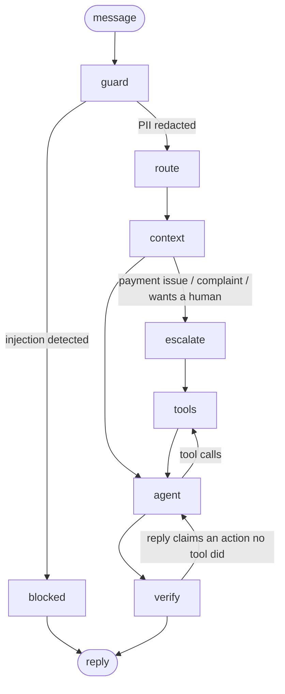

# support-agent

A customer support agent for **Cellar & Co.**, a fictional wine, beer and spirits retailer. It looks up and changes orders, issues refunds within limits, answers stock questions using a demand forecast, and hands off to a human when it should. It runs entirely on local models (Ollama).

Built with **LangGraph** (orchestration), **LlamaIndex** (retrieval), **MCP** (tool serving) and **Qwen** models on two consumer GPUs.

> **Status:** Day 2 of 3. Done: the agent, tools, guardrails, MCP server, evals, and a router comparison (prompting vs. retrieval vs. LoRA fine-tuning). Coming next (Day 3): a FastAPI service, demo UI and the feedback loop.

## Results

### Agent (69 scenarios, ground truth checked against the database)

| Router | Core (49) | Hard (20) | Tool-call accuracy | Latency p50 / p95 |
|---|---|---|---|---|
| kNN | 49/49 | 20/20 | 100% | 4.1s / 7.2s |
| Fine-tuned (LoRA, Ollama) | 49/49 | 20/20 | 100% | 5.0s / 12.0s |

The hard set covers typos, multi-turn context ("ok, cancel it"), no order number, two requests in one message, conditional requests ("if it's out of stock, cancel my order"), fake-policy social engineering, refund over-claims, and the $100/$101 approval boundary.

Both routers pass everything, so routing accuracy doesn't limit the agent on this set. The fine-tuned run is slower end to end because a second model shares the GPUs with the 14B agent model; the router call itself is faster.

### Intent router (325 held-out messages, 28 intents)

| Router | Bitext held-out (270) | Product, simple (15) | Product, hard (40) | Latency p50 | Training |
|---|---|---|---|---|---|
| Prompting: qwen2.5:3b, intent list in prompt | 80.7% | 93.3% | 87.5% | 124ms | none |
| Retrieval: kNN vote over bge-small embeddings | 97.4% | 100% | 100% | 55ms | none |
| **Fine-tuned: QLoRA on Qwen2.5-3B, served by Ollama (q4_K_M)** | **98.1%** | **100%** | **100%** | **50ms** | 12 min, RTX 3060 |
| Same adapter in transformers (4-bit bitsandbytes) | 99.3% | 100% | not run | 253ms | (same) |

The product sets were written by hand (by Claude, not by the model that generated the synthetic training data). The hard set uses slang, typos and brand nicknames ("yo do yall have hennessy", "need a 30 rack of natty light, is it back yet"). Every message in them is a product question, so they measure recall for that intent, not false positives; the Bitext set covers those. A set written by a person is planned (`evals/human_product_questions.txt`).

Each run is also recorded in [ml-eval-harness](https://github.com/rama-kata/ml-eval-harness) (`evals/results/results.db`), so `uv run evalrun compare --db evals/results/results.db` lists them side by side.

- **Fine-tuning vs. prompting the same model:** +17 points and 2.5× faster. The fine-tuned prompt is one line; the baseline's lists all 28 intents.
- **kNN is the default** because it needs no training and is within a point of the fine-tuned router on this data. Bitext's phrasing is uniform, which favours retrieval.
- **Quantization cost:** 99.3% → 98.1% going from the bf16-merged adapter to Ollama's 4-bit model, for 5× lower latency.

## Architecture



| Node | What it does |
|---|---|
| `guard` | Redacts card numbers (Luhn-checked), SSNs and CVVs before any model or log sees them. Blocks prompt injection patterns. |
| `route` | Classifies the message into one of 28 intents (27 from Bitext plus `product_inquiry`). |
| `context` | Builds the system prompt: the intent's **playbook** (required action), the 2 most relevant policy sections, and one past resolution for tone. |
| `escalate` | For intents that must reach a human, the graph files the ticket **in code**; the model only writes the reply. |
| `agent` / `tools` | qwen3:14b with 9 tools, looping until it answers. |
| `verify` | Checks that every action the reply claims ("has been cancelled", "refund approved") was done by a successful tool call this turn. If not: one retry with only the claimed tool offered, then a safe handoff to a human. A false claim never reaches the customer. |

### Tools

`search_help_center`, `list_my_orders`, `lookup_order`, `cancel_order`, `change_shipping_address`, `request_refund`, `search_products`, `stock_outlook`, `escalate_to_human`

`stock_outlook` calls the XGBoost demand forecaster from my [retail-inventory-ai](https://github.com/rama-kata/retail-inventory-ai) project (installed as a dependency) to estimate days until an item sells out.

## Design decisions

- **The customer id comes from the session, never from the model.** Tools read it from LangGraph's run config, which the model can't see or set. An injected "show orders for customer 7" has no path to another account's data. This is tested in `tests/test_tools.py` and the `other_customer` eval scenarios.
- **Code where an action must happen, the model where judgment helps.** Early versions asked the model to escalate complaints; it would say "let me escalate this" and not call the tool. Escalation is now a graph edge. The same goes for the 21+ age rule, enforced inside the product tools rather than in the prompt, and refund limits (over $100 goes to a supervisor), enforced in `request_refund`.
- **Facts the reply must contain go in the tool result.** For refunds over $100 the model kept skipping the supervisor review and once invented a confirmation email. Adding a `tell_customer` field to the tool output fixed both. Models follow tool output more reliably than system prompt rules.
- **The router earns its place.** It doesn't just label messages; each intent maps to a playbook, and escalation intents change the graph's path.
- **Policies are the source of truth; past conversations set tone only.** Bitext responses are generic templates that contradict this store's rules, so they're retrieved as tone examples and the prompt says their facts may be wrong.
- **The dataset didn't cover the business.** Bitext has no product or stock intent, so `product_inquiry` was added: 708 synthetic training messages generated by qwen3:14b from real catalog names, and test messages written by hand so the test doesn't reward the generator's own style.
- **Verify claims, don't trust them.** The worst support-bot failure is saying "I've cancelled your order" without doing it. The `verify` node compares the reply's claims with this turn's successful tool calls. In testing, qwen3 ignored the retry note as a system message but reliably made the call when the note was a user-role message offering only the claimed tool.
- **Check the test set before trusting a score.** The first kNN router scored 100%. Bitext contains surface variants of each sentence (lowercased, punctuation stripped, typos), and a random split put variants on both sides. The split now keeps each sentence family on one side and removes training rows within 0.95 cosine similarity of a test row (3,615 of them). kNN dropped to an honest 97.4%.
- **Serve the fine-tuned model on the same engine as the baseline.** The LoRA router was slower than prompting (253ms) when run through transformers with 4-bit bitsandbytes. Merged, converted to GGUF and served by Ollama like the baseline, it takes 50ms. (Ollama's own safetensors import produced a model that only output "????"; llama.cpp's converter works. See `training/export_ollama.py`.)

## Data

| Source | Use |
|---|---|
| [Bitext customer support dataset](https://www.kaggle.com/datasets/bitext/bitext-gen-ai-chatbot-customer-support-dataset) (Kaggle, 27K messages, 27 intents) | Router training/testing, past-resolution examples |
| [Montgomery County, MD Warehouse and Retail Sales](https://data.montgomerycountymd.gov/d/v76h-r7br) (341K rows, 24 months) | Real product catalog and monthly sales history for forecasting. The [Kaggle mirror](https://www.kaggle.com/datasets/divyeshardeshana/warehouse-and-retail-sales) has only 10 months, too few for 12-month lag features, so the full table comes from the county's open data portal. |

Prices, stock levels, customers and orders are synthetic and seeded, so the database and eval scenarios are reproducible.

Bitext is split before anything is built: 10 messages per intent (270) are held out for testing and never indexed or trained on.

## Run it

Requires [uv](https://docs.astral.sh/uv/) and [Ollama](https://ollama.com/).

```bash
ollama pull qwen3:14b && ollama pull qwen2.5:3b
uv sync --extra dev

uv run python scripts/download_data.py    # Kaggle + county open data, no token needed
uv run python scripts/build_store.py      # synthetic store on real SKUs -> data/store.db
uv run python scripts/prepare_data.py     # train/test split + KB examples
uv run python scripts/build_index.py      # LlamaIndex embeddings -> data/index/
uv run python scripts/generate_product_inquiries.py   # synthetic product_inquiry training data

uv run support-agent --customer 1 --debug # chat in the terminal
```

The router defaults to kNN, which needs no training. Choose another with `SUPPORT_AGENT_ROUTER=prompt|knn|finetuned`.

### Fine-tune the router (optional, one 12 GB GPU)

```bash
ollama stop qwen3:14b    # free the GPU
CUDA_VISIBLE_DEVICES=0 uv run --extra train python training/train_router.py \
    --base Qwen/Qwen2.5-3B-Instruct --out models/router-qwen2.5-3b     # ~12 min on an RTX 3060

git clone --depth 1 https://github.com/ggml-org/llama.cpp ~/repos/llama.cpp
uv run --extra train --with ~/repos/llama.cpp/gguf-py --with sentencepiece \
    python training/export_ollama.py models/router-qwen2.5-3b --name support-router-3b
```

### Evals and tests

```bash
uv run pytest                                   # guardrails + tool security, no models needed
uv run python scripts/make_scenarios.py         # regenerate golden scenarios from the store
uv run python evals/run_agent_eval.py           # 69 scenarios on a fresh copy of the store
uv run python evals/run_router_eval.py --router prompt|knn|finetuned|lora
```

### MCP

The tools are also served over MCP, bound to one customer per session:

```json
{
  "mcpServers": {
    "cellar-and-co": {
      "command": "uv",
      "args": ["--directory", "/path/to/support-agent", "run", "support-agent-mcp", "--customer", "1"]
    }
  }
}
```

## Project layout

```
src/support_agent/
  graph.py        LangGraph agent: guard, route, context, escalate, agent, tools
  tools.py        the 9 tools, scoped to the session's customer
  router.py       intent routers: prompting, kNN, LoRA (PyTorch) and fine-tuned (Ollama)
  retrieval.py    LlamaIndex indexes: policies, past resolutions, products
  guardrails.py   PII redaction, prompt-injection detection
  store.py        SQLite data access
  mcp_server.py   tools over MCP
  kb/policies.md  store policies (source of truth)
scripts/          data download, store build, leak-free splits, index build, synthetic data,
                  scenario generation
training/         QLoRA router training and export to Ollama (GGUF)
evals/            golden scenarios, product-intent test set, eval runners
tests/            guardrail and tool-security tests on a fixture database
```
