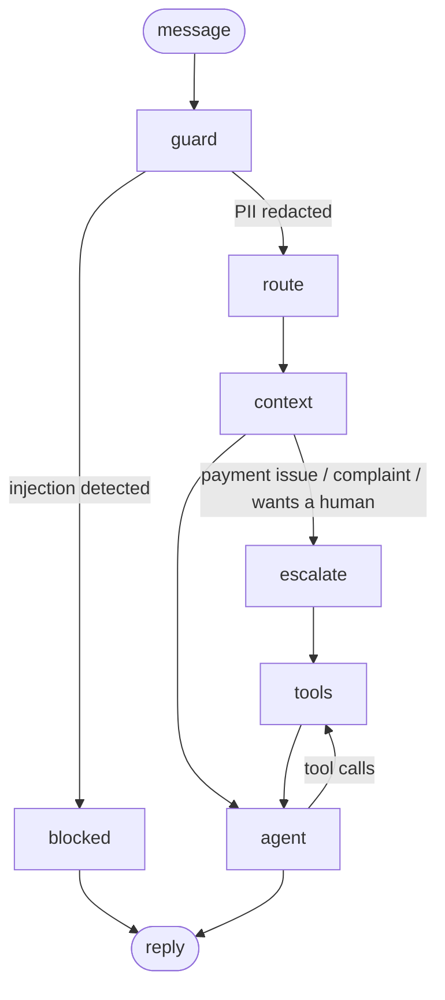

# support-agent

A customer support agent for **Cellar & Co.**, a fictional wine, beer and spirits retailer. It looks up and changes orders, issues refunds within limits, answers stock questions using a demand forecast, and hands off to a human when it should. It runs entirely on local models (Ollama).

Built with **LangGraph** (orchestration), **LlamaIndex** (retrieval), **MCP** (tool serving) and **Qwen** models on two consumer GPUs.

> **Status:** Day 1 of 3. The agent, tools, guardrails, MCP server and evals work. Coming next: a LoRA-fine-tuned router compared against prompting and RAG (Day 2), then a FastAPI service, demo UI and the feedback loop (Day 3).

## Results (Day 1 baseline)

| Eval | Result |
|---|---|
| Agent scenarios (49, ground truth checked against the DB) | **49/49 passed** |
| Tool-call accuracy | **100%** |
| Agent latency, p50 / p95 | 3.5s / 7.3s (qwen3:14b, RTX 3060 + RTX 2070 Super) |
| Intent router accuracy, prompting (qwen2.5:3b, 285 held-out messages) | **78.6%** at 126ms |

A perfect score on 49 scenarios means the scenario set is too easy, not that the agent is perfect. Harder multi-turn, typo and multi-intent cases are next.

## Architecture



| Node | What it does |
|---|---|
| `guard` | Redacts card numbers (Luhn-checked), SSNs and CVVs before any model or log sees them. Blocks prompt injection patterns. |
| `route` | Classifies the message into one of 28 intents (27 from Bitext plus `product_inquiry`). |
| `context` | Builds the system prompt: the intent's **playbook** (required action), the 2 most relevant policy sections, and one past resolution for tone. |
| `escalate` | For intents that must reach a human, the graph files the ticket **in code**; the model only writes the reply. |
| `agent` / `tools` | qwen3:14b with 9 tools, looping until it answers. |

### Tools

`search_help_center`, `list_my_orders`, `lookup_order`, `cancel_order`, `change_shipping_address`, `request_refund`, `search_products`, `stock_outlook`, `escalate_to_human`

`stock_outlook` calls the XGBoost demand forecaster from my [retail-inventory-ai](https://github.com/rama-kata/retail-inventory-ai) project (installed as a dependency) to estimate days until an item sells out.

## Design decisions

- **The customer id comes from the session, never from the model.** Tools read it from LangGraph's run config, which the model can't see or set. An injected "show orders for customer 7" has no path to another account's data. This is tested in `tests/test_tools.py` and the `other_customer` eval scenarios.
- **Code where an action must happen, the model where judgment helps.** Early versions asked the model to escalate complaints; it would say "let me escalate this" and not call the tool. Escalation is now a graph edge. The same goes for the 21+ age rule, enforced inside the product tools rather than in the prompt, and refund limits (over $100 goes to a supervisor), enforced in `request_refund`.
- **Facts the reply must contain go in the tool result.** For refunds over $100 the model kept skipping the supervisor review and once invented a confirmation email. Adding a `tell_customer` field to the tool output fixed both. Models follow tool output more reliably than system prompt rules.
- **The router earns its place.** It doesn't just label messages; each intent maps to a playbook, and escalation intents change the graph's path.
- **Policies are the source of truth; past conversations set tone only.** Bitext responses are generic templates that contradict this store's rules, so they're retrieved as tone examples and the prompt says their facts may be wrong.
- **The dataset didn't cover the business.** Bitext has no product or stock intent, so `product_inquiry` was added, with hand-written test messages. Fine-tuning will need synthetic training data for it.

## Data

| Source | Use |
|---|---|
| [Bitext customer support dataset](https://www.kaggle.com/datasets/bitext/bitext-gen-ai-chatbot-customer-support-dataset) (Kaggle, 27K messages, 27 intents) | Router training/testing, past-resolution examples |
| [Montgomery County, MD Warehouse and Retail Sales](https://data.montgomerycountymd.gov/d/v76h-r7br) (341K rows, 24 months) | Real product catalog and monthly sales history for forecasting. The [Kaggle mirror](https://www.kaggle.com/datasets/divyeshardeshana/warehouse-and-retail-sales) has only 10 months, too few for 12-month lag features, so the full table comes from the county's open data portal. |

Prices, stock levels, customers and orders are synthetic and seeded, so the database and eval scenarios are reproducible.

Bitext is split before anything is built: 10 messages per intent (270) are held out for testing and never indexed or trained on.

## Run it

Requires [uv](https://docs.astral.sh/uv/) and [Ollama](https://ollama.com/).

```bash
ollama pull qwen3:14b && ollama pull qwen2.5:3b
uv sync --extra dev

uv run python scripts/download_data.py    # Kaggle + county open data, no token needed
uv run python scripts/build_store.py      # synthetic store on real SKUs -> data/store.db
uv run python scripts/prepare_data.py     # train/test split + KB examples
uv run python scripts/build_index.py      # LlamaIndex embeddings -> data/index/

uv run support-agent --customer 1 --debug # chat in the terminal
```

### Evals and tests

```bash
uv run pytest                                   # guardrails + tool security, no models needed
uv run python scripts/make_scenarios.py         # regenerate golden scenarios from the store
uv run python evals/run_agent_eval.py           # 49 scenarios on a fresh copy of the store
uv run python evals/run_router_eval.py          # intent accuracy on held-out messages
```

### MCP

The tools are also served over MCP, bound to one customer per session:

```json
{
  "mcpServers": {
    "cellar-and-co": {
      "command": "uv",
      "args": ["--directory", "/path/to/support-agent", "run", "support-agent-mcp", "--customer", "1"]
    }
  }
}
```

## Project layout

```
src/support_agent/
  graph.py        LangGraph agent: guard, route, context, escalate, agent, tools
  tools.py        the 9 tools, scoped to the session's customer
  router.py       intent router interface + prompting baseline
  retrieval.py    LlamaIndex indexes: policies, past resolutions, products
  guardrails.py   PII redaction, prompt-injection detection
  store.py        SQLite data access
  mcp_server.py   tools over MCP
  kb/policies.md  store policies (source of truth)
scripts/          data download, store build, splits, index build, scenario generation
evals/            golden scenarios, product-intent test set, eval runners
tests/            guardrail and tool-security tests on a fixture database
```
